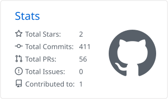
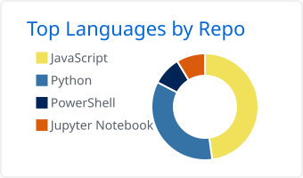

<a href="./README.md">🇬🇧 English</a> · <strong>🇪🇸 Español</strong>

<h2 align="center">¡Hola! 👋</h2>

<b>Backend · APIs · Datos · Automatización</b>

<!-- Generadas localmente por .github/workflows/profile-stats.yml. Ejecútalo manualmente desde Actions cuando sea necesario. -->

  <a href="https://github.com/maestre7">
    <picture>
      <source media="(prefers-color-scheme: dark)" srcset="./profile-summary-card-output/github_dark/3-stats.svg" />
      
    </picture>
  </a>
  <a href="https://github.com/maestre7">
    <picture>
      <source media="(prefers-color-scheme: dark)" srcset="./profile-summary-card-output/github_dark/1-repos-per-language.svg" />
      
    </picture>
  </a>

<h3 align="center">Lenguajes y herramientas</h3>

<b>Lenguajes y backend</b>

  
  
  
  
  
  

<b>Frontend</b>

  
  
  
  

<b>Datos y automatización</b>

  
  
  
  
  

  
  
  
  

<b>Bases de datos</b>

  
  
  
  
  

<b>Infraestructura y herramientas</b>

  
  
  
  
  
  
  
  

<b>IA para desarrollo</b>

  
  

<!--
  A ChatGPT activity heatmap can be added here once there is a verified
  source of usage data (for example, locally aggregated ChatGPT export).
  Do not publish conversations, tokens, authentication data, or invented counts.
-->
